# Manual técnico inicial — Podio

**Proyecto:** Podio, PWA para la gestión de torneos de natación, aguas abiertas, acuatlón, triatlón y atletismo
**Curso:** Taller Front End 2 · **Equipo:** Brayan Teran y Paolo Mauceri · **Versión:** 0.1.0 (Sprint 1) · **Fecha:** 21 de noviembre de 2026

---

## 1. Introducción y alcance

Podio centraliza la **inscripción de atletas**, el **registro de tiempos** y la **publicación de resultados** de torneos de deportes acuáticos y de resistencia. Esta entrega corresponde al **50 % inicial** del sistema (Sprint 1):

| Incluido en esta versión | Planificado (Sprints 2 a 4) |
|---|---|
| Entorno React + Vite (PWA) y Node.js + Express | Gestión de torneos, pruebas y categorías |
| Base de datos MySQL con datos de prueba | Inscripción de atletas y asignación de dorsales |
| Registro, inicio de sesión y roles (ADMIN, JUEZ, ATLETA) | Registro de tiempos por el juez (con modo sin conexión) |
| Página de inicio con próximos torneos reales | Resultados en vivo con Socket.IO |
| Dashboard administrativo y creación de jueces | Perfil e historial del atleta |
| API documentada con OpenAPI (Swagger UI) | Exportación de resultados |

## 2. Metodología SCRUM

### 2.1 Qué es SCRUM

SCRUM es un marco de trabajo ágil para desarrollar productos complejos en **ciclos cortos llamados sprints**, al final de los cuales se entrega un **incremento** funcionando. Se apoya en tres pilares:

- **Transparencia:** el trabajo pendiente y su avance son visibles para todos (tablero, backlog, burndown).
- **Inspección:** el equipo revisa con frecuencia el producto y el proceso (review, daily, retrospectiva).
- **Adaptación:** según lo que se observa, se ajustan el plan y la forma de trabajar.

### 2.2 Roles, eventos y artefactos

| Elemento | En SCRUM | Cómo lo aplicamos en Podio |
|---|---|---|
| **Product Owner** | Maximiza el valor del producto y prioriza el backlog | Rota cada sprint; en el Sprint 1 es Paolo Mauceri |
| **Scrum Master** | Facilita el proceso y elimina impedimentos | Rota cada sprint; en el Sprint 1 es Brayan Teran |
| **Developers** | Construyen el incremento | Brayan y Paolo, que trabajan todo en conjunto |
| **Stakeholder** | Recibe y valida el producto | El docente del curso |
| **Sprint** | Ciclo de duración fija | Sprint 1 de 3 días (19–21 nov); los siguientes, de 1 semana |
| **Sprint Planning** | Se eligen las historias y se dividen en tareas | 1 h al inicio: 13 historias, 40 puntos, 23 tareas |
| **Daily Scrum** | Sincronización diaria de 15 min | 10 min por llamada o chat |
| **Sprint Review** | Demostración del incremento | Esta entrega (PDF y video) |
| **Retrospectiva** | Mejora del proceso | Al cierre de cada sprint |
| **Product Backlog** | Lista priorizada de lo que se quiere construir | 30 historias de usuario en 7 épicas (MoSCoW + Fibonacci) |
| **Sprint Backlog** | Lo comprometido en el sprint | Historias y tareas del Sprint 1 |
| **Incremento** | Producto funcionando al final del sprint | La versión 0.1.0 descrita en este manual |

La planificación completa (roles, backlog priorizado, criterios de aceptación, Definition of Ready y de Done, Sprint 1, burndown, riesgos y retrospectiva) está en [`docs/01-scrum/planificacion-scrum.md`](../01-scrum/planificacion-scrum.md).

### 2.3 Herramienta de gestión: Jira

El backlog se gestiona en **Jira Cloud** (proyecto Scrum). El archivo [`docs/01-scrum/jira-backlog.csv`](../01-scrum/jira-backlog.csv) carga automáticamente las 7 épicas, 30 historias y 23 subtareas con sus relaciones, puntos, prioridades y el Sprint 1. Los pasos están en [`importar-en-jira.md`](../01-scrum/importar-en-jira.md).

El tablero tiene las columnas **Por hacer → En curso → En revisión → Hecho**.

## 3. Arquitectura y tecnologías

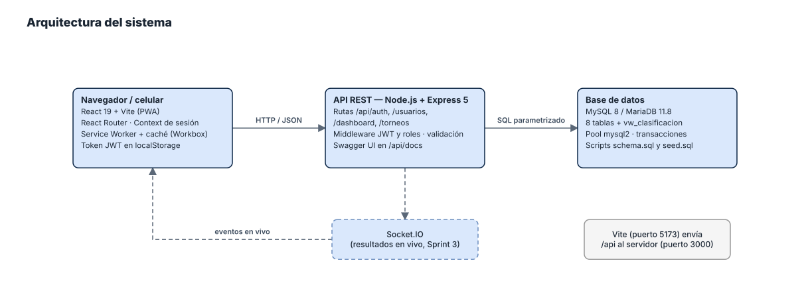

| Capa | Tecnología | Por qué la elegimos |
|---|---|---|
| Interfaz | **React 19 + Vite 8** | Componentes reutilizables y recarga instantánea en desarrollo |
| Navegación | **React Router 7** | Rutas por página y rutas protegidas por rol |
| PWA | **vite-plugin-pwa (Workbox)** | Manifest, íconos y service worker con caché sin configuración manual |
| Estilos | **CSS Modules + variables CSS** | Estilos aislados por componente y un sistema de diseño con tokens |
| Iconos y fuentes | **Lucide**, **Inter** y **Barlow Semi Condensed** (`@fontsource`) | Iconos SVG consistentes y fuentes que funcionan sin conexión |
| API | **Node.js 26 + Express 5** | JavaScript en todo el proyecto; Express 5 maneja errores asíncronos |
| Base de datos | **MySQL 8** (driver `mysql2`) | Relacional, con claves foráneas, restricciones `CHECK` y vistas |
| Autenticación | **JWT** (`jsonwebtoken`) + **bcryptjs** | Sesión sin estado en el servidor y contraseñas cifradas |
| Validación | **express-validator** | Reglas declarativas y mensajes por campo |
| Documentación | **OpenAPI 3.0.3 + Swagger UI** | Documentación interactiva para probar la API |
| Pruebas | **Vitest**, **Supertest**, **Testing Library** | Pruebas rápidas de la API y de los componentes |

> **Nota sobre la base de datos:** en nuestra región la descarga de MySQL y Workbench está bloqueada por Oracle (error 403 de exportación). En desarrollo usamos **MariaDB 11.8 LTS**, creada por los autores originales de MySQL y compatible con él. Los scripts están escritos en SQL estándar de MySQL y funcionan en ambos motores.

## 4. Estructura del repositorio

```
podio/
├── client/                    Frontend (React + Vite, PWA)
│   ├── public/                Íconos de la PWA y logo SVG
│   └── src/
│       ├── api/               Cliente HTTP (apiFetch) y manejo del token
│       ├── auth/              Contexto de sesión y rutas protegidas
│       ├── components/        ui/ (botón, campo, alerta, diálogo…), layout/, home/, admin/, auth/
│       ├── pages/             Inicio, Login, Registro, 404 y admin/ (dashboard)
│       ├── styles/            tokens.css (sistema de diseño) y global.css
│       └── utils/             Formato de fechas y tiempos, validaciones
├── server/                    API REST (Node.js + Express)
│   ├── openapi.yaml           Especificación OpenAPI
│   ├── scripts/db-reset.js    Recrea la base de datos con datos de prueba
│   ├── src/
│   │   ├── config/            Variables de entorno
│   │   ├── db/                Pool de conexiones y transacciones
│   │   ├── middleware/        Autenticación, roles, validación, errores
│   │   └── modules/           auth, usuarios, dashboard, torneos, health
│   └── tests/                 Pruebas de la API (Vitest + Supertest)
├── database/                  schema.sql, seed.sql, 00-usuario-dev.sql
├── docs/                      Documentación (SCRUM, UI/UX, base de datos, este manual)
└── scripts/capturas.mjs       Toma automática de capturas para el manual
```

## 5. Diagramas de flujo

Los diagramas se editan en Draw.io (`docs/04-manual-tecnico/diagramas/*.drawio`). Los que tienen borde punteado describen funciones planificadas para los Sprints 2 y 3.

### 5.1 Inicio de sesión

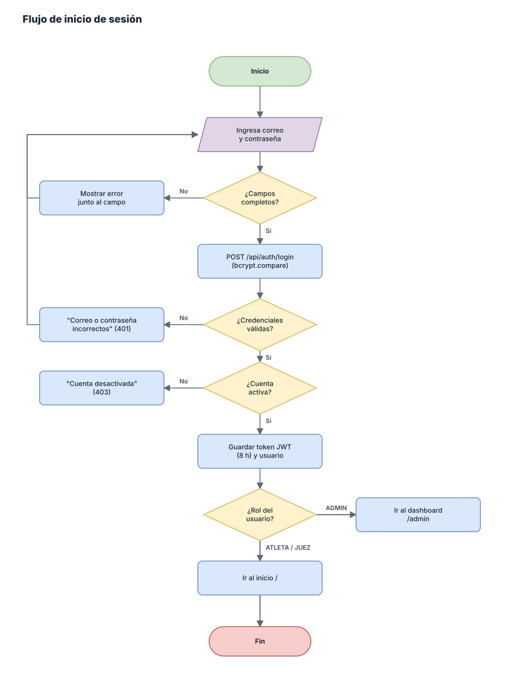

### 5.2 Registro de atleta

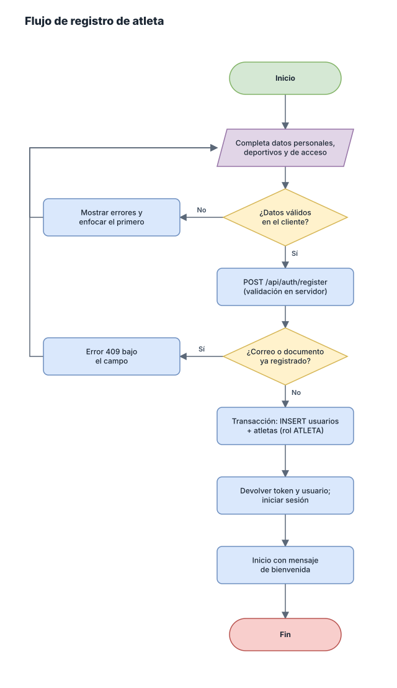

### 5.3 Inscripción a una prueba (Sprint 2)

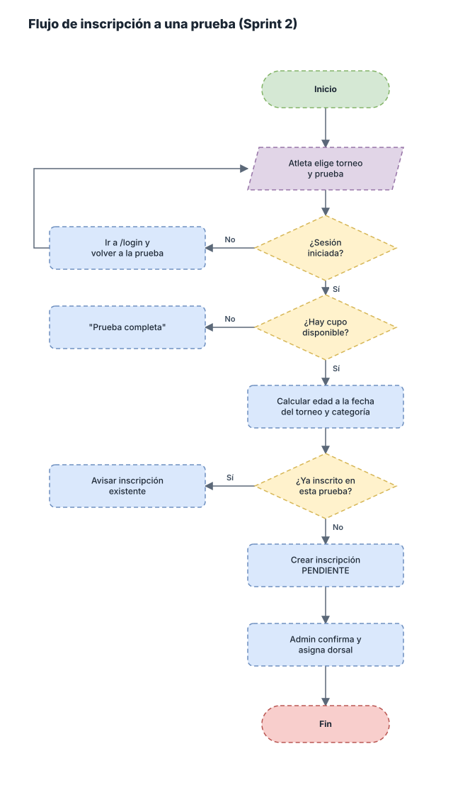

### 5.4 Registro de tiempos del juez (Sprint 3)

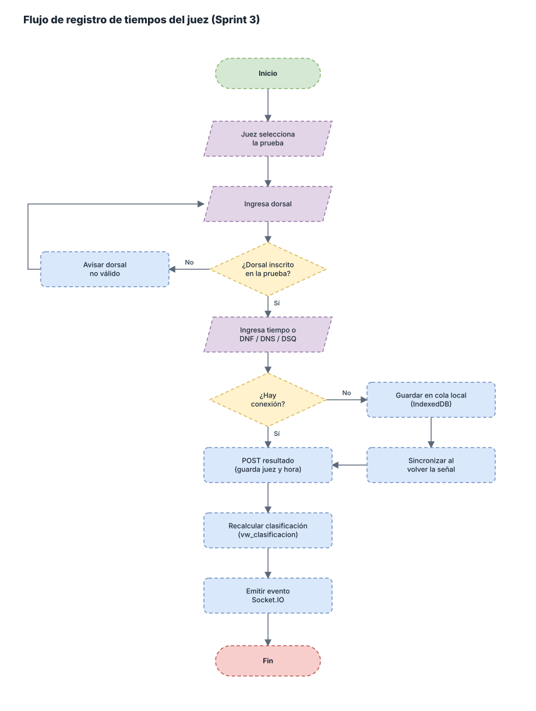

### 5.5 Resultados en vivo (Sprint 3)

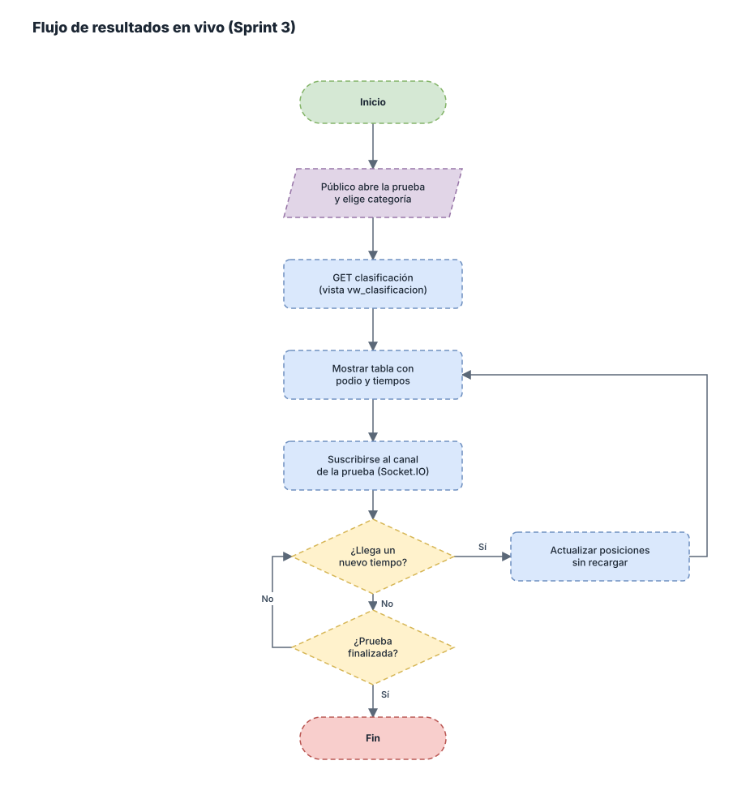

## 6. Modelo de datos

La base `torneos_db` tiene **8 tablas** y una vista. La explicación completa de cada entidad y sus cardinalidades está en [`docs/03-base-de-datos/README.md`](../03-base-de-datos/README.md).

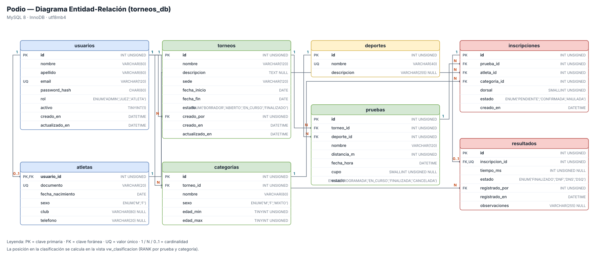

Decisiones principales:

- **`usuarios` + `atletas` (1 : 0..1):** todos los usuarios comparten la tabla de cuentas; los datos deportivos solo existen para los atletas.
- **Restricciones en la base:** correo y documento únicos, dorsal único por prueba, `CHECK` de fechas, de edades y de tiempos.
- **Posición calculada, no guardada:** la vista `vw_clasificacion` usa `RANK() OVER (PARTITION BY prueba, categoría ORDER BY tiempo_ms)`, así una corrección de tiempo actualiza la clasificación automáticamente.
- **Tiempos en milisegundos** (`INT UNSIGNED`), sin parciales por tramo.

## 7. API REST y OpenAPI

La especificación está en [`server/openapi.yaml`](../../server/openapi.yaml) y se puede probar en **http://localhost:3000/api/docs**.

| Método | Ruta | Acceso | Descripción |
|---|---|---|---|
| GET | `/api/health` | Público | Estado de la API y de la base de datos |
| POST | `/api/auth/register` | Público | Registro de atleta (siempre con rol ATLETA) |
| POST | `/api/auth/login` | Público | Inicio de sesión; devuelve el token JWT |
| GET | `/api/auth/me` | Con sesión | Usuario de la sesión actual |
| GET | `/api/usuarios` | ADMIN | Lista paginada de usuarios, con filtro por rol |
| POST | `/api/usuarios` | ADMIN | Crear usuario JUEZ o ADMIN |
| GET | `/api/dashboard/resumen` | ADMIN | Indicadores del panel de administración |
| GET | `/api/torneos/proximos` | Público | Próximos torneos para la página de inicio |

Todas las respuestas de error usan el mismo formato:

```json
{ "error": { "code": "EMAIL_TAKEN", "message": "Este correo ya está registrado", "details": [{ "campo": "email", "mensaje": "Este correo ya está registrado" }] } }
```

| Código | HTTP | Cuándo ocurre |
|---|---|---|
| `VALIDATION_ERROR` | 400 | Datos inválidos (con detalle por campo) |
| `INVALID_CREDENTIALS` | 401 | Correo o contraseña incorrectos |
| `UNAUTHORIZED` | 401 | Falta el token, es inválido o expiró |
| `USER_INACTIVE` / `FORBIDDEN` | 403 | Cuenta desactivada o rol sin permiso |
| `EMAIL_TAKEN` / `DOCUMENTO_TAKEN` | 409 | Correo o documento ya registrados |
| `DB_UNAVAILABLE` | 503 | La base de datos no responde |

## 8. Seguridad

| Medida | Implementación |
|---|---|
| Contraseñas | Cifradas con **bcrypt** (costo 10); nunca se devuelven en la API |
| Sesión | **JWT** firmado (HS256) con expiración de 8 horas |
| Roles | Middleware `requireAuth` + `requireRole`; además se verifica en la base que la cuenta siga activa |
| Registro público | Ignora cualquier campo `rol` enviado: siempre crea ATLETA |
| Inyección SQL | Todas las consultas son **parametrizadas** (`mysql2`) |
| Enumeración de usuarios | El login responde igual si el correo no existe o la contraseña es incorrecta |
| Cabeceras HTTP | **helmet** (CSP, X-Frame-Options, etc.) y **CORS** limitado al frontend |
| Errores | Nunca se envía el *stack* al cliente; mensajes genéricos ante errores inesperados |
| Integridad | Registro en **transacción**: si falla el perfil del atleta, no queda una cuenta huérfana |

> **Decisión consciente:** el token se guarda en `localStorage` para poder probar la API cómodamente con el botón *Authorize* de Swagger. Para producción se recomienda migrar a una cookie `httpOnly` y `SameSite`, que protege mejor ante ataques XSS.

## 9. Aplicación web progresiva (PWA)

- **Manifest** con nombre, colores e íconos (incluido un ícono *maskable*), generado por `vite-plugin-pwa`.
- **Service worker** (Workbox) que guarda en caché la aplicación: la interfaz abre aunque no haya conexión.
- La consulta de **próximos torneos** usa la estrategia *Network First*: si no hay red, se muestra la última copia guardada.
- **Instalable** desde el navegador (ícono de instalar en la barra de direcciones) al usar la versión de producción (`npm run build` + `npm run preview`).
- Diseño *mobile-first* con botones de al menos 44 px, tema claro y oscuro, y contraste AA.

## 10. Capturas del avance

Capturas tomadas automáticamente con `npm run capturas` sobre la aplicación funcionando.

### Página de inicio
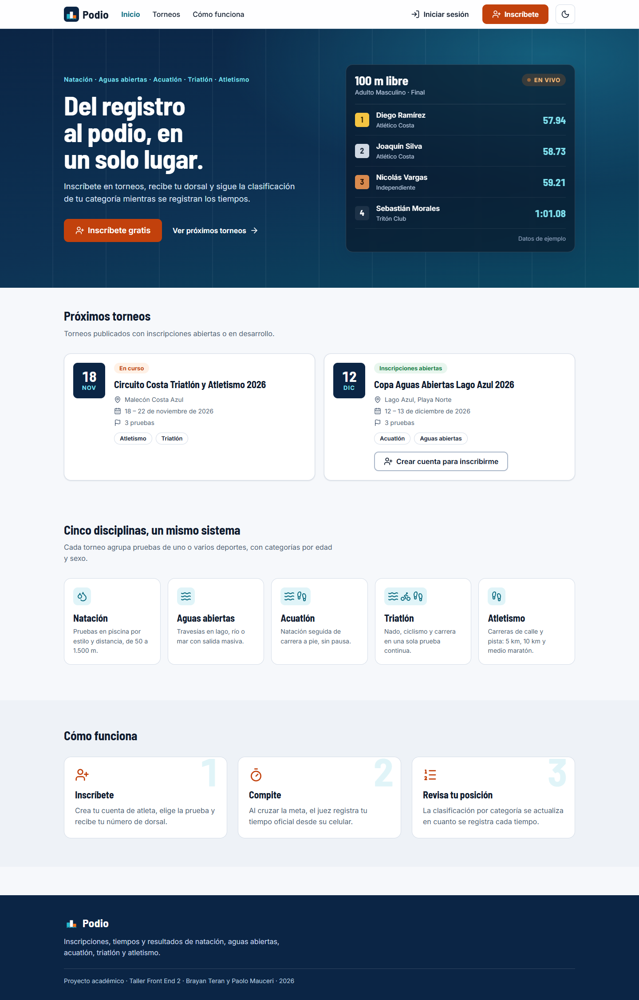

### Inicio en celular y en modo oscuro
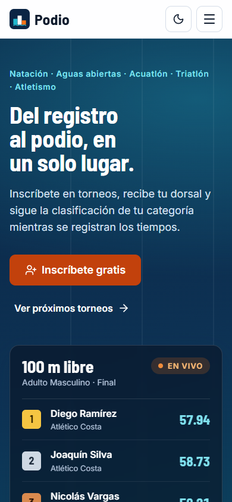
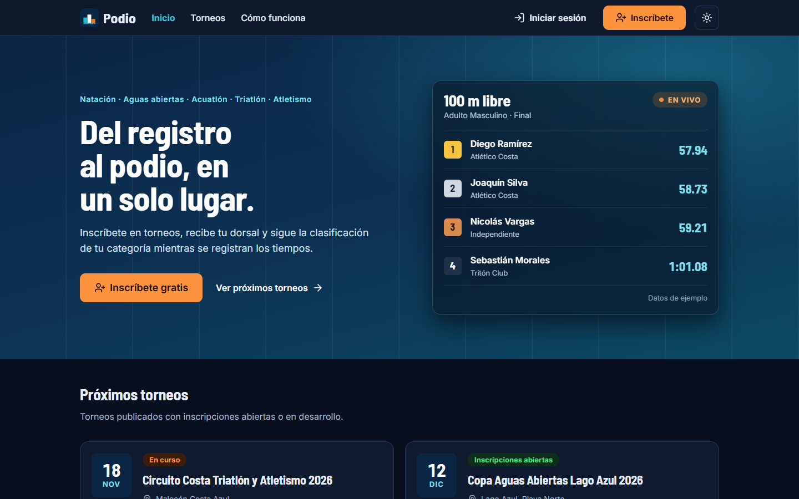

### Inicio de sesión

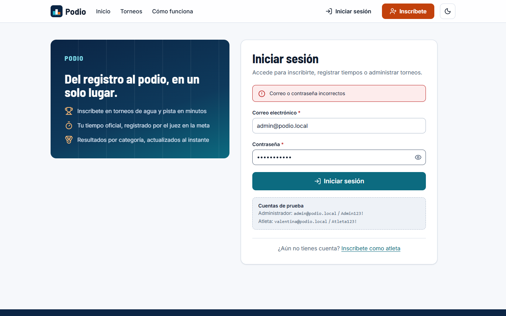

### Registro de atleta con validaciones
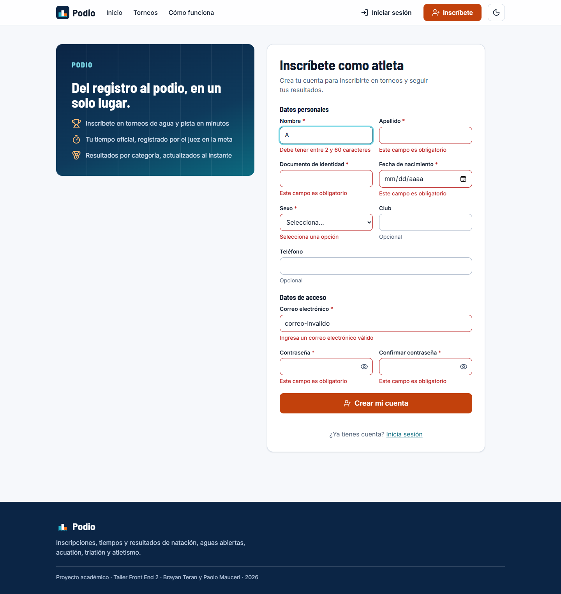

### Dashboard administrativo
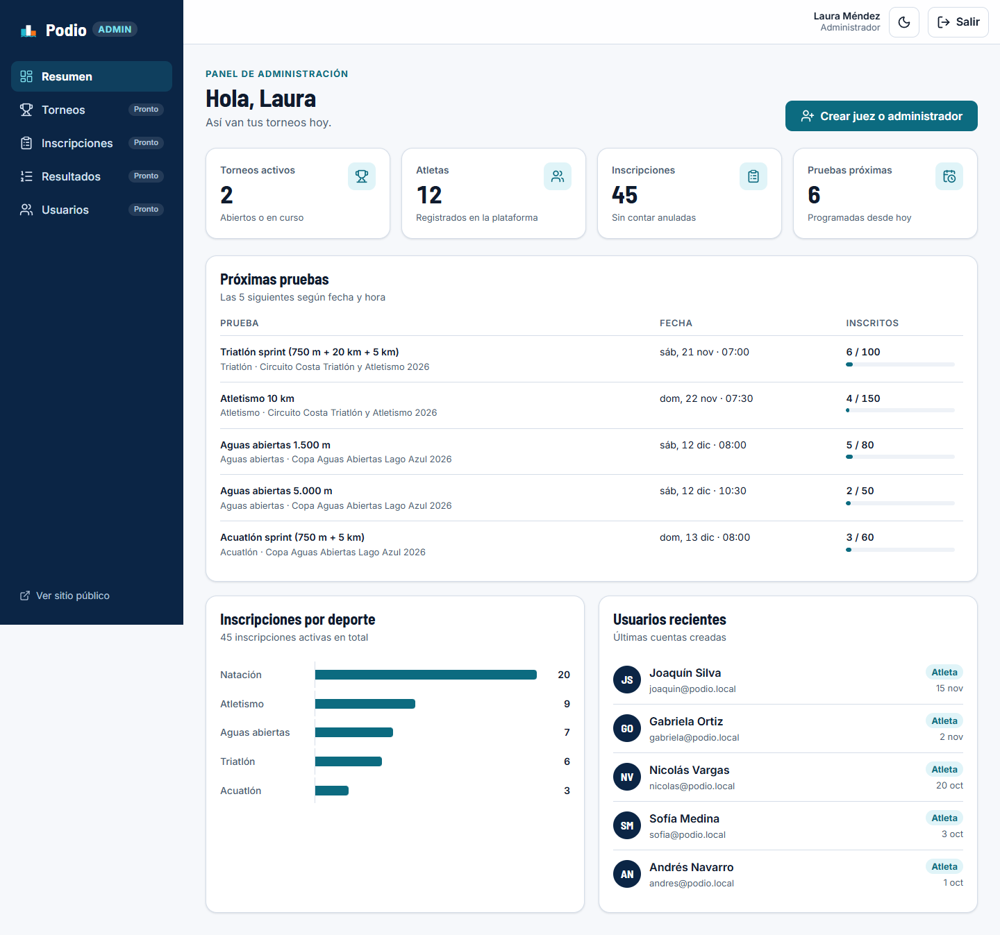
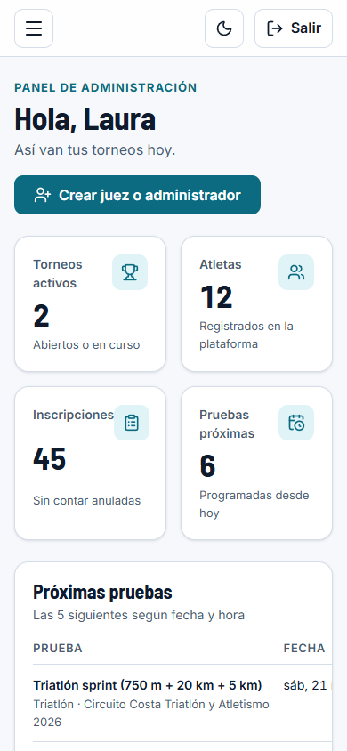

### Creación de jueces y administradores
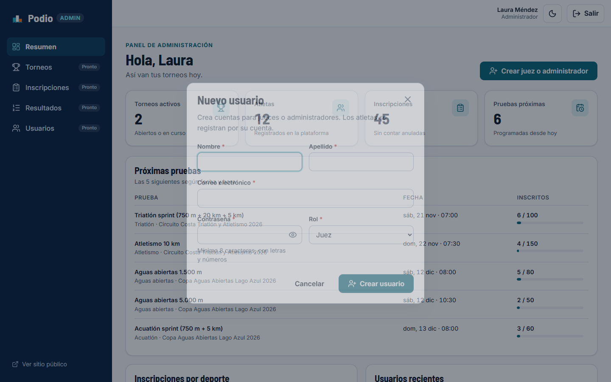

### Secciones del Sprint 2
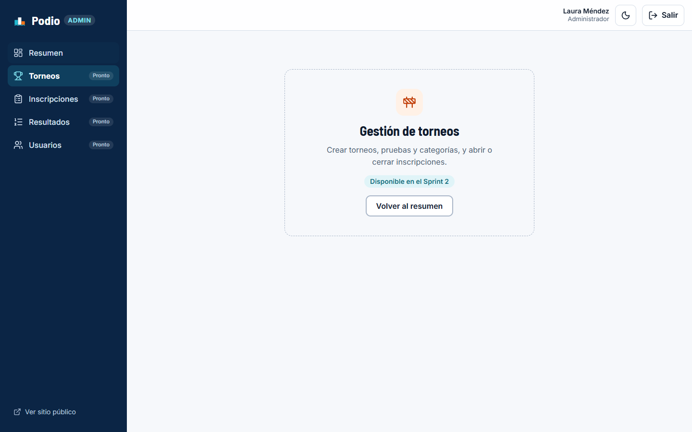

### Documentación de la API (Swagger UI)
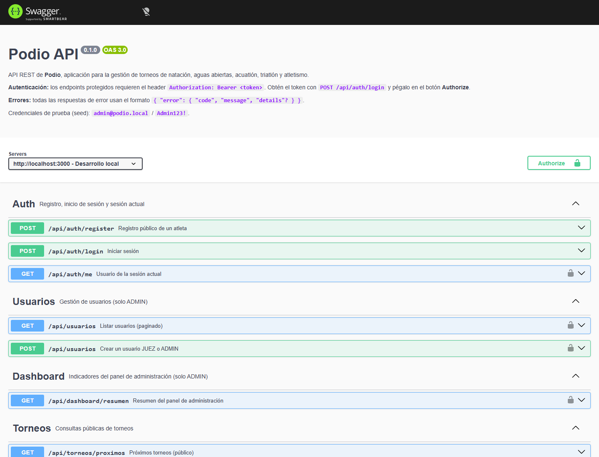
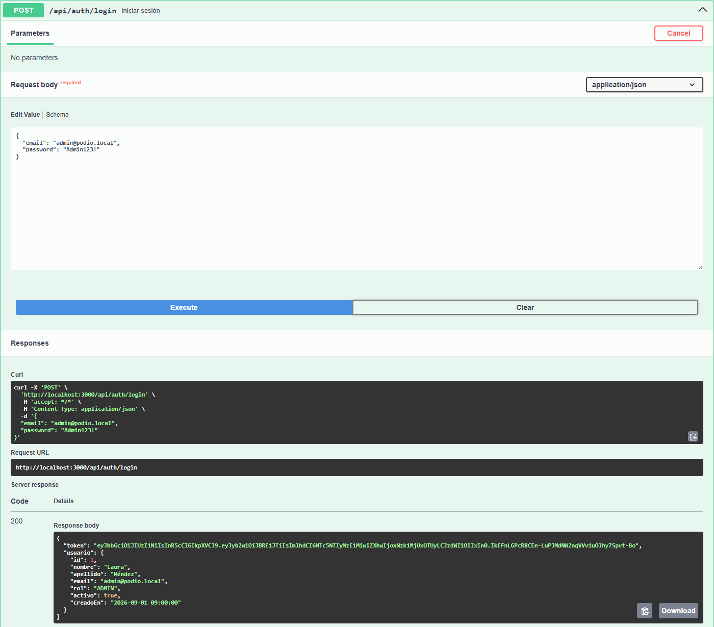

### Health check y página 404
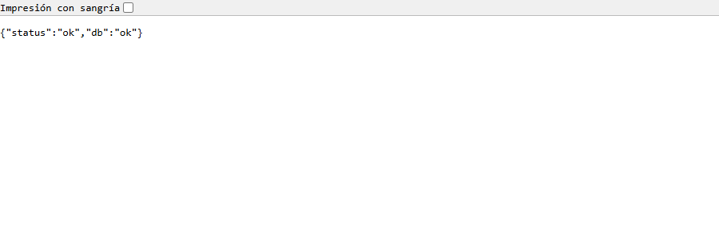
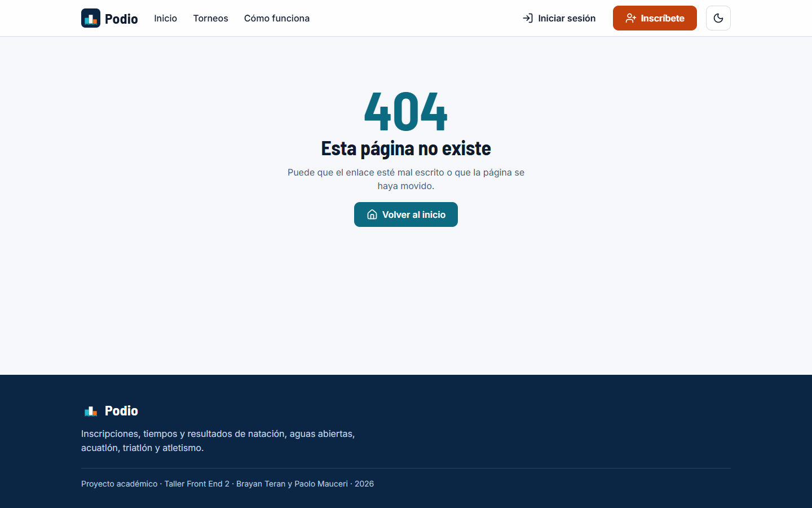

## 11. Tutorial de instalación del entorno de desarrollo

### 11.1 Requisitos

| Herramienta | Versión | Cómo verificar |
|---|---|---|
| Node.js | LTS (22 o superior) | `node -v` |
| MySQL 8.4 **o** MariaDB 11.8 | LTS | `mysql --version` |
| Git | Cualquiera reciente | `git --version` |
| Microsoft Edge o Google Chrome | Actual | — (solo para `npm run capturas`) |

La guía detallada de instalación en Windows, incluida la alternativa con MariaDB si Oracle bloquea la descarga, está en [`docs/00-instalacion/instalacion-entorno.md`](../00-instalacion/instalacion-entorno.md).

### 11.2 Pasos

```powershell
# 1. Clonar el repositorio y entrar a la carpeta
git clone <url-del-repositorio> podio
cd podio

# 2. Instalar dependencias (raíz, server y client)
npm run install:all

# 3. Crear el usuario de la base de datos (una sola vez, pide la clave de root)
mysql -u root -p -e "source database/00-usuario-dev.sql"

# 4. Configurar el backend
copy server\.env.example server\.env
#    Edita server\.env y cambia JWT_SECRET por una cadena larga y aleatoria:
#    node -e "console.log(require('crypto').randomBytes(48).toString('hex'))"
#    Para las pruebas, crea server\.env.test igual pero con DB_NAME=torneos_test

# 5. Crear la base de datos con los datos de prueba
npm run db:reset

# 6. Levantar la API y la web
npm run dev
```

| Servicio | URL |
|---|---|
| Aplicación web | http://localhost:5173 |
| API | http://localhost:3000/api |
| Documentación de la API | http://localhost:3000/api/docs |

### 11.3 Cuentas de prueba

| Rol | Correo | Contraseña |
|---|---|---|
| Administrador | `admin@podio.local` | `Admin123!` |
| Juez | `juez@podio.local` | `Juez123!` |
| Atleta | `valentina@podio.local` | `Atleta123!` |

### 11.4 Comandos útiles

| Comando | Qué hace |
|---|---|
| `npm run dev` | Levanta API y web al mismo tiempo |
| `npm run db:reset` | Borra y recrea la base con datos de prueba |
| `npm test` | Ejecuta las pruebas de la API y del frontend |
| `npm run build --prefix client` | Genera la versión de producción de la PWA |
| `npm run capturas` | Vuelve a tomar las capturas de este manual |

### 11.5 Problemas frecuentes

| Síntoma | Solución |
|---|---|
| `npm.ps1 no se puede cargar… ejecución de scripts deshabilitada` | `Set-ExecutionPolicy -Scope CurrentUser -ExecutionPolicy RemoteSigned`, o usar `npm.cmd` |
| `El operador '<' está reservado` en PowerShell | Usar `mysql -u root -p -e "source archivo.sql"` |
| `/api/health` responde `DB_UNAVAILABLE` | Iniciar el servicio MySQL/MariaDB y revisar `server/.env` |
| `Access denied for user 'podio'` | Ejecutar el paso 3 (`00-usuario-dev.sql`) |
| Instalación lenta o `EPERM` | El proyecto está en OneDrive: pausar la sincronización |

## 12. Pruebas automáticas

```powershell
npm test
```

| Proyecto | Archivos | Pruebas | Qué cubren |
|---|---|---|---|
| `server` | 6 | 50 | Health check, manejo de errores, registro (duplicados, transacción, rol forzado), login, tokens inválidos o vencidos, permisos por rol, paginación, dashboard, OpenAPI |
| `client` | 6 | 32 | Cliente HTTP (errores, sin conexión, 401), rutas protegidas, login, registro, página de inicio (carga, vacío, error), dashboard y creación de usuarios |

Las pruebas de la API usan una base aparte (`torneos_test`) que se recrea automáticamente antes de cada ejecución.

## 13. Próximos pasos

| Sprint | Fechas | Objetivo |
|---|---|---|
| 2 | 23 – 29 nov 2026 | Gestión de torneos, pruebas y categorías; inscripción de atletas |
| 3 | 30 nov – 6 dic 2026 | Dorsales, panel del juez, resultados en vivo con Socket.IO |
| 4 | 7 – 13 dic 2026 | Modo sin conexión del juez, historial del atleta, exportación y prueba real en la Copa Lago Azul |
