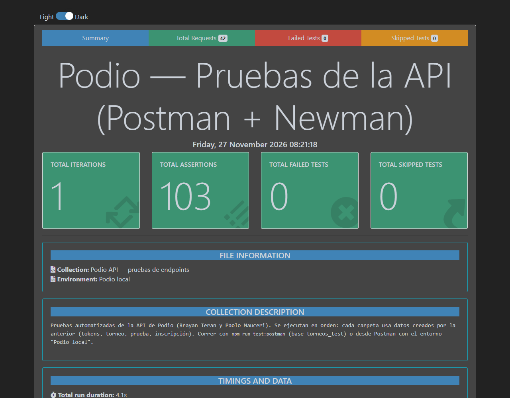
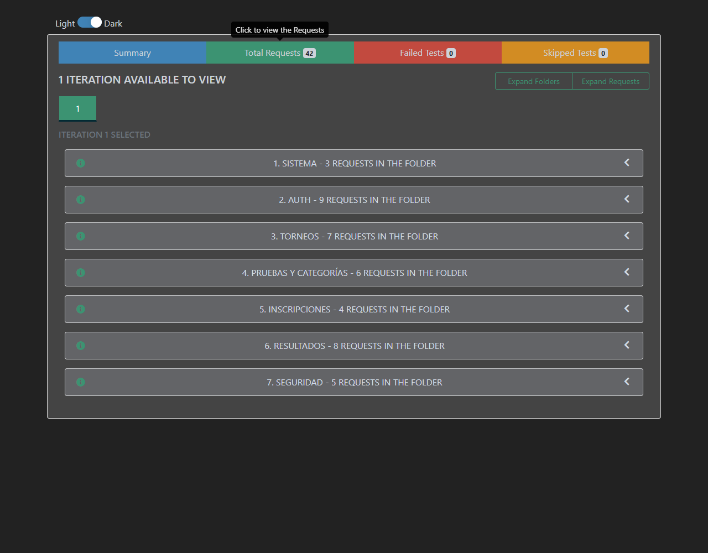

# Informe de pruebas y errores corregidos — Podio

**Proyecto:** Podio, PWA para la gestión de torneos multideporte
**Integrantes:** Brayan Teran · Paolo Mauceri
**Fecha de la última ejecución:** 27 de noviembre de 2026

## 1. Resumen

| Tipo de prueba | Herramienta | Alcance | Resultado |
|---|---|---|---|
| Unitarias y de componentes (frontend) | **Jest** + Testing Library | 27 archivos: componentes, páginas, hooks, cola sin conexión, caché | **150 / 150** |
| Integración de la API (backend) | Vitest + Supertest | 15 archivos contra la base `torneos_test` | **188 / 188** |
| Endpoints (caja negra) | **Postman** + Newman | 42 requests en 7 carpetas, 103 aserciones | **103 / 103** |
| Recorrido completo | Playwright (Microsoft Edge) | admin → atletas → juez → público, escritorio y móvil | Sin errores |

Todas las pruebas se ejecutan sin pasos manuales y vuelven a crear la base de datos de prueba antes de empezar. Así cada corrida parte de los mismos datos.

## 2. Cómo ejecutarlas

Requisitos: MySQL/MariaDB local con el usuario de desarrollo (ver `docs/00-instalacion/`) y las dependencias instaladas (`npm run install:all`).

| Qué | Comando (desde la raíz) | Dónde ver el resultado |
|---|---|---|
| Frontend (Jest) | `npm test --prefix client` | Consola |
| Backend (Vitest) | `npm test --prefix server` | Consola |
| Ambas | `npm test` | Consola |
| Postman / Newman | `npm run test:postman` | Consola y `docs/05-pruebas/reportes/newman-reporte.html` |
| Todo | `npm run test:all` | — |

`npm run test:postman` recrea la base `torneos_test` y levanta la API en el puerto 3001. Luego corre la colección y genera el reporte HTML y el JSON. Termina con código de salida distinto de 0 si alguna aserción falla.

La colección también se puede abrir en la aplicación Postman: importar `docs/05-pruebas/postman/podio.postman_collection.json` y el entorno `podio-local.postman_environment.json`, y ejecutar la colección completa con el *Collection Runner*, en orden. Antes hay que levantar la API apuntando a `torneos_test`.

## 3. Pruebas de componentes React con Jest

Se usan Jest 30, `babel-jest` y un entorno jsdom propio (`client/src/test/entorno-jsdom.cjs`) que agrega `Response`, `Headers` y `structuredClone` de Node. Las pruebas usan Testing Library para buscar elementos como lo haría una persona: por rol, etiqueta o texto. La API se simula ruta por ruta (`client/src/test/mockApi.js`), Socket.IO con un socket falso (`socketFalso.js`) e IndexedDB con `fake-indexeddb`.

| Área | Qué se comprueba (ejemplos) |
|---|---|
| Autenticación | inicio de sesión, rutas protegidas por rol, sesión que se conserva sin conexión y se borra con 401 |
| Panel de administración | crear torneo, mover su estado, pruebas, categorías que se cruzan (mensaje del servidor), inscribir atletas, usuarios |
| Panel del juez | `parseTiempo` (`12:34.56` → 754 560 ms, rechaza `60:00` o `0:00.00`), formulario de tiempo, búsqueda por dorsal, actualización en vivo |
| Sin conexión | cola en IndexedDB: el último tiempo gana, 401 no pierde nada, 409 queda «rechazado» con su motivo, no se envía dos veces |
| Resultados | podio con empates (dos 1.º lugar), DNF fuera del podio, pestañas por categoría, actualización por Socket.IO sin volver a pedir datos |
| PWA | aviso «Sin conexión», qué respuestas guarda el *service worker* (nunca las pedidas con sesión) |

## 4. Pruebas de la API con Vitest y Supertest

Cada archivo crea sus propios torneos, pruebas y atletas sobre `torneos_test`. Los casos cubren las reglas del negocio:

- **Inscripciones.** Categoría y dorsal automáticos. Dos inscripciones simultáneas reciben dorsales distintos. También se comprueban cupo lleno, inscripción repetida, atleta sin categoría (`SIN_CATEGORIA`) y torneo no abierto.
- **Resultados.** Solo con el torneo en curso, salvo que el administrador corrija un torneo finalizado. Un tiempo FINALIZADO lleva tiempo y DNF/DNS/DSQ no. En los empates se comparte la posición y la siguiente salta. Las inscripciones anuladas no cuentan.
- **Tiempo real.** Quien sigue una prueba por Socket.IO recibe la clasificación al guardar un tiempo, y quien sigue otra no.
- **Seguridad.** Hay control de roles en cada ruta y los torneos en borrador no aparecen para el público. Un campo enviado como lista o un JSON mal formado responden 400 y no 500. El inicio de sesión tiene límite de intentos.

## 5. Pruebas de endpoints con Postman

La colección tiene 7 carpetas que se ejecutan en orden y se pasan datos entre sí: tokens, `torneoId`, `pruebaId` e `inscripcionId`.

| Carpeta | Requests | Qué valida |
|---|---|---|
| 1. Sistema | 3 | health check, índice, 404 con formato de error |
| 2. Auth | 9 | login de los tres roles (guarda tokens), contraseña incorrecta 401, validación 400, registro 201, correo repetido 409, `me` con y sin token |
| 3. Torneos | 7 | crear (201, nace en BORRADOR), fechas al revés 400, atleta 403, lista pública sin borradores, transición inválida 409 |
| 4. Pruebas y categorías | 6 | crear prueba (fecha normalizada), prueba fuera de fecha 400, categorías, categoría que se cruza 409, abrir inscripciones |
| 5. Inscripciones | 4 | inscripción con categoría y dorsal automáticos, repetida 409, juez 403, mis inscripciones |
| 6. Resultados | 8 | tiempo con torneo abierto 409, iniciar torneo, registrar tiempo 200, tiempo 0 y DNF con tiempo 400, atleta 403, clasificación pública con posición 1, mis resultados |
| 7. Seguridad | 5 | inyección SQL en la búsqueda, token adulterado 401, campo como lista 400, JSON mal formado 400, cabeceras de seguridad |

Cada request comprueba el código HTTP y la forma del cuerpo; algunas además miden que la respuesta llegue en menos de 2 segundos.

## 6. Errores encontrados y corregidos

Cada corrección tiene una prueba automatizada que fallaba antes del cambio y pasa después, así que el error no puede volver sin que una prueba lo detecte. La excepción es la #4, que es de diseño y se verificó con capturas en móvil.

| # | Descripción | Causa | Corrección | Prueba que lo cubre |
|---|---|---|---|---|
| 1 | Con la API o la base de datos caídas, la app cerraba la sesión del usuario | El proxy respondía 502 sin cuerpo y se trataba como sesión inválida | Los 502/503/504 sin cuerpo se tratan como «sin conexión» y el token se conserva | `client.test.js` (502/503/504), `AuthContext.test.jsx` «conserva el token si…» |
| 2 | Los enlaces del menú a secciones del inicio (`#torneos`) no desplazaban la página | React Router cambia la URL sin hacer el desplazamiento nativo | Componente `ScrollToHash` en el diseño público | `ScrollToHash.test.jsx` |
| 3 | Crear una prueba con fecha y hora inválida respondía 500 | El saneador de express-validator corría aunque la validación ya había fallado | `.bail()` antes de normalizar la fecha | `pruebas.test.js` «valida distancia, deporte y formato de fecha» |
| 4 | En el celular, las celdas de las tablas se mostraban en fila y se cortaban | El contenido de la celda quedaba como hijo directo de la grilla | Contenedor `.valor` en cada celda | Revisión visual con Playwright a 390 px de ancho (sin desplazamiento horizontal) |
| 5 | El indicador «En vivo» quedaba en «Sin conexión» aunque el socket estaba conectado | En local el socket conectaba antes de que la página escuchara el evento `connect` | Estado de conexión con `useSyncExternalStore` | `useResultadosEnVivo.test.jsx` «marca en vivo aunque el socket se conecte justo antes…» |
| 6 | Un tiempo viejo de la cola sin conexión podía pisar uno nuevo | La sincronización recorría una copia de la cola tomada al empezar | Se relee la cola antes de cada envío y el guardado directo espera a la sincronización | `colaResultados.test.js` «no reenvía un ítem que se quitó…» |
| 7 | Un tiempo guardado con la sesión vencida se perdía | Solo los errores de red iban a la cola | 401 y 5xx también guardan el tiempo en el dispositivo | `RegistroTiemposPage.test.jsx` «con la sesión vencida (401)…» |
| 8 | El juez no podía seguir si recargaba la app sin señal | La sesión y la lista de inscritos se pedían al servidor | Se recuerda el último usuario y una copia de los inscritos, que se borran al cerrar sesión | `AuthContext.test.jsx` «sin red usa el último usuario…», `RegistroTiemposPage.test.jsx` «sin red usa la última lista…» |
| 9 | Un visitante sin sesión podía ver torneos en borrador desde la caché | El *service worker* guardaba respuestas pedidas por un administrador | Las lecturas públicas van sin token y solo esas se guardan | `cacheApi.test.js`, `publico.test.js` |
| 10 | Enviar un campo como lista (`{"estado": ["DNF"]}`) respondía 500 | express-validator valida cada elemento de una lista por separado | La validación rechaza listas y objetos en el cuerpo (400) | `resultados.test.js`, `inscripciones.test.js` y Postman «Campo enviado como lista» |
| 11 | Un dorsal 65535 hacía fallar todas las inscripciones siguientes de la prueba | El siguiente dorsal automático excedía el tamaño de la columna | Dorsal manual entre 1 y 9999 | `inscripciones.test.js` «el dorsal máximo es 9999…» |

### Limitaciones conocidas

Se documentan para un trabajo futuro. No afectan el uso normal:

- Si un tiempo falla siempre con error 500 del servidor, los tiempos que están detrás en la cola esperan hasta que ese se corrija o se descarte.
- Volver a guardar un tiempo existente lo redondea a centésimas, la precisión con la que lo escribe el juez.
- La cola sin conexión pertenece al dispositivo: si dos jueces usan el mismo teléfono, el tiempo queda registrado a nombre de quien lo envía.
